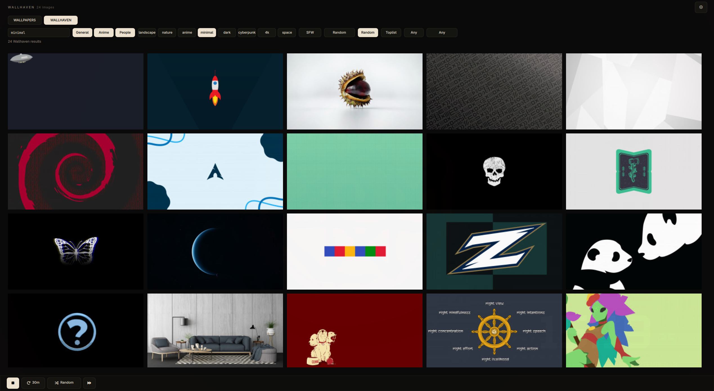
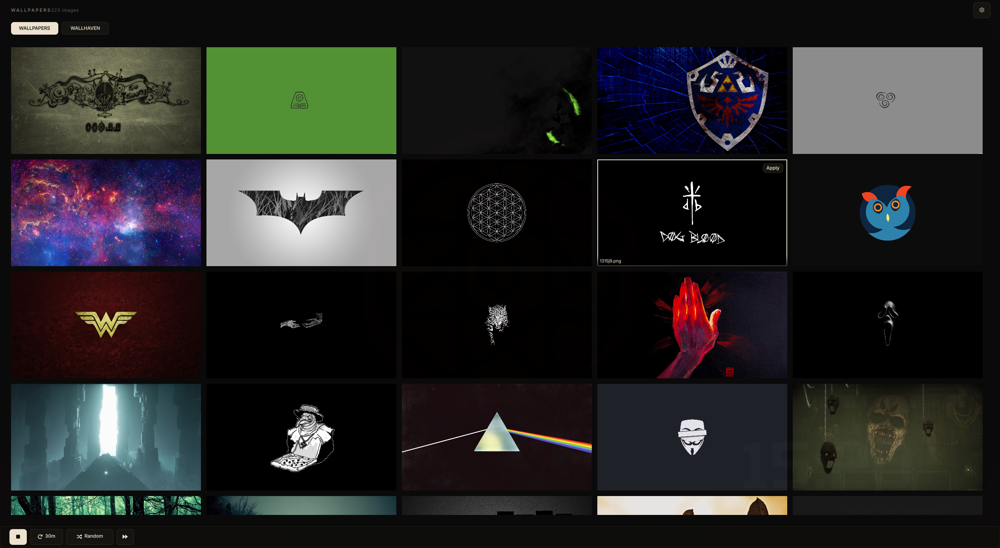

# Wallpaper Picker

A fullscreen Omarchy wallpaper picker that grids every image in your
Pictures folder — click one to set it as your wallpaper, or let the
built-in rotation timer cycle them automatically. Opens as a regular
app window from the launcher or a keybind.




This is a maintained fork of [maiosx/wallpicker](https://github.com/maiosx/wallpicker),
the plugin originally written by **maiosx**. It adds a full
[Wallhaven](https://wallhaven.cc) integration (see below) on top of the
original local-folder picker, plus a few robustness fixes.

## What's new in this fork

- **Wallpaper rotation** — a built-in timer cycles your wallpapers
  randomly or in folder order (15m → Daily), survives shell restarts,
  and is controllable from the toolbar, the Settings tab, keybinds or IPC.
- **Launcher app, not a bar widget** — the plugin opens as a regular
  app window from the app grid or a keybind, with no bar widget.
- **Wallhaven integration** — browse Wallhaven straight from the picker:
  live search, General/Anime/People category toggles, purity filter
  (SFW / Sketchy), and sorting (Relevance / Top / Latest / *Toplist* /
  *Random*).
- **Curated tag chips** — one click to filter by landscape, nature, anime,
  minimal, dark, cyberpunk, 4k or space, and they sit on their own row so
  the filter bar still fits narrow windows.
- **Any aspect ratio** — the ratio button also offers "Any" (unfiltered),
  instead of only fixed ratios, and the cycle order is persisted to config.
- **Infinite scroll** — results auto-load the next Wallhaven page whenever
  the grid has room for more, including tiny windows.
- **Full-resolution preview** — hover any thumbnail for an **Apply** /
  **Download** overlay; download saves the full-res image to your Pictures
  folder and refreshes the local grid.
- **Narrow-window layout** — the Wallhaven filter bar wraps its tag chips
  onto a second line.
- **Config sync fix** — "Any" ratio, sorting and tag selections now write
  through to `~/.config/omarchy/wallpicker.json` reliably (and reload from
  disk without restart).
- **Desktop-entry fix** — the launcher entry is located from the plugin's
  own path instead of a stripped manifest field, so it installs correctly
  on current Omarchy releases.

Everything the original did — folder grid, rotation, keybinds, IPC — still
works unchanged.

## Install

```bash
omarchy plugin add https://github.com/redeyes-jpg/wallpaper-picker.git --enable --yes
```

No bar widget — the plugin registers itself in the app launcher
(`~/.local/share/applications/wallpicker.desktop`, auto-removed when the
plugin is disabled). Launch **Wallpapers** from the app grid (SUPER+SPACE),
or set a keybind from the settings tab.

## Use

- **Launch** from the app grid, or via IPC: `omarchy-shell wallpicker open`
- Click any thumbnail to apply it immediately.
- Escape closes the window.
- **Gear button** (top right) opens the Settings tab; **← back button**
  returns to the grid.

### Rotation

The footer toolbar (and the Settings → Rotation section) control rotation:

- **Start/Stop** — toggles the rotation timer.
- **Interval** — cycles 15m → 30m → 1h → 3h → 6h → 12h → Daily → Off.
- **Random/Sequential** — picks images at random (never the same one
  twice in a row) or walks the folder in sorted order.
- **Rotate now** — applies the next wallpaper immediately.

Rotation survives shell restarts: the timer re-arms to the remaining
time, and the last-applied image + cursor are stored in
`~/.local/state/omarchy/wallpicker/rotation.json`.

### Keybinds

The Settings → Keybinds tab has three typed fields:
**open picker**, **toggle rotation** (start when off, stop when on),
and **rotate now**. Type a combo like `SUPER + W` and press **Enter**
or the **Apply** button next to the field.
A conflict popup appears if another Hyprland bind already uses that
combo — choose **Replace** to override or **Cancel** to back out.
After applying, the app rechecks `wallpicker.lua` and the live
`hyprctl binds` table and only then shows **Applied: `<combo>`**,
so you get confirmation the bind really took effect.
They are written to `~/.config/hypr/wallpicker.lua`
and activated by a managed `require("hypr.wallpicker")` line in
`~/.config/hypr/hyprland.lua`. Leaving a keybind empty means it is not
bound — nothing is written until you set one.

IPC:

```bash
omarchy-shell wallpicker toggle|open|close|status
omarchy-shell wallpicker toggleRotation|cycleNow|setInterval <minutes>|rotationStatus
```

## Configuration

Everything is editable from the Settings tab (folder, recursion, rotation),
persisted to `~/.config/omarchy/wallpicker.json`. The CLI also exposes it:

```bash
wallpicker-cli config show
wallpicker-cli config set rotationIntervalMin 15
wallpicker-cli next                     # apply next wallpaper now
wallpicker-cli keybinds apply|clear
wallpicker-cli desktop install|remove
```

Defaults:

- `picturesDir` — `~/Pictures` (point it at any folder)
- `recursive` — `false` (include subfolders)
- `columns` — `5` (grid columns)
- `rotationEnabled` — `false`
- `rotationIntervalMin` — `30`
- `rotationRandom` — `true`

## How wallpaper-setting works

On click this plugin runs Omarchy's own CLI:

```bash
omarchy theme bg set "<chosen image>"
```

via `Util.execDetached(...)` (the same helper Omarchy's own plugins use).
Earlier drafts of this plugin manually symlinked
`~/.config/omarchy/current/background` and relaunched `swaybg` by hand —
that fought the CLI over state it owns (it actually tracks the current
background under `~/.local/state/omarchy/current/`) and silently did
nothing on current Omarchy releases. Letting `omarchy theme bg set` do
it is what Omarchy's own community plugins (e.g. grid-wallpaper-picker)
do, and it's the version that actually works.

## Remove

```bash
omarchy plugin disable wallpicker.grid
omarchy plugin remove wallpicker.grid --yes
```

Disabling removes the launcher entry and any managed keybinds cleanup
runs automatically.

## Notes / things to double check on your machine

- Relies on `omarchy theme bg set <path>` being available on your
  Omarchy version. Run it once from a terminal with a real image path
  to confirm it works on your system before relying on the plugin.
- Requires `jq` for the CLI and `findutils` for image listing.
- The Quickshell `Process`/`StdioCollector` API used for listing files
  matches the pattern Omarchy's own plugins use, but if your Quickshell
  version's IPC API differs slightly, check `qs.Io`/`Quickshell.Io`
  docs and adjust `listProc`.

## Credits

Original author: **maiosx** — [maiosx/wallpicker](https://github.com/maiosx/wallpicker)
(MIT). This fork lives at
[redeyes-jpg/wallpaper-picker](https://github.com/redeyes-jpg/wallpaper-picker).